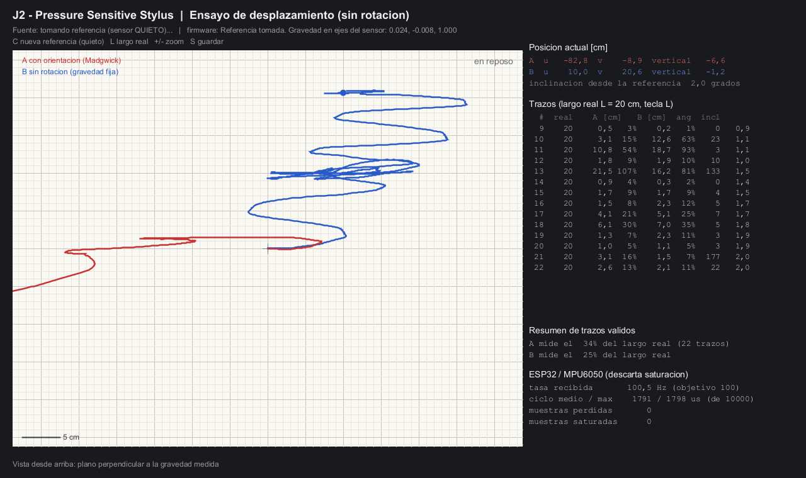

## 30-09-2026

**Actividades realizadas**

* Recepción de los materiales provistos por la cátedra para el desarrollo del proyecto:
  * Placa de desarrollo ESP32
  * Módulo sensor MPU6050
  * Protoboard
  * Cable USB
* Verificación física de los componentes recibidos.

## 01-10-2026

**Actividades realizadas**

* Montaje del circuito en protoboard conectando el ESP32 con el MPU6050 vía I2C.
* Configuración del entorno de desarrollo en PlatformIO.
* Carga del firmware en el ESP32 y verificación del entorno.
* Desarrollo y ejecución de 4 tests unitarios/funcionales:
  * **Test I2C:** Verificación de comunicación exitosa y detección de ID correspondiente a MPU6050 original (dirección `0x68`).
  * **Test de lectura cruda:** Adquisición continua a 100 Hz estables con un jitter de ±1 µs.
  * **Test de calibración:** Medición de la deriva del giróscopo, registrando 30°/min sin corregir y reduciéndose a menos de 1°/min tras aplicar compensación de bias.
  * **Test de Madgwick:** Validación del filtro con un tiempo de cómputo de 25 µs por muestra, adoptando un factor β = 0.1.

## 03-10-2026

**Actividades realizadas**

* Se realizaron pruebas del firmware en un segundo ESP32 disponible, ya que el hardware principal no estaba accesible en ese momento.
* Fue necesario ajustar los pines de comunicación I2C ya que la asignación de pines difería entre las placas.
* Se detectó que el bus I2C fallaba de forma intermitente en la protoboard a alta velocidad. Se redujo la frecuencia de comunicación y la conexión se estabilizó.
* Se verificó mediante un programa de escaneo I2C que el MPU6050 es detectado correctamente en la dirección esperada.

## 05-10-2026

**Actividades realizadas**

* Se detectó un problema recurrente: luego de algunos movimientos bruscos, el firmware dejaba de responder y enviaba siempre los mismos valores por serial.
* Se identificó que la librería de comunicación I2C quedaba bloqueada ante errores sin ser detectados. Se agregó verificación de errores en cada lectura y una rutina de recuperación automática que reinicia el bus tras varios fallos consecutivos.
* Se agregó una espera al inicio para asegurarse de que el MPU6050 esté listo antes de continuar con la inicialización.

## 06-10-2026

**Actividades realizadas**

* Se desarrolló un visualizador 3D en Processing 4 para validar el movimiento del lápiz en pantalla contra el movimiento físico del MPU6050.
* El visualizador recibe la orientación por puerto serie y representa el lápiz como un objeto 3D rotando en tiempo real.
* Se implementó la funcionalidad de resetear la orientación de referencia en cualquier momento, útil para compensar la posición inicial del sensor.
* Al validar el movimiento con el visualizador se observó que el lápiz rotaba solo incluso cuando el sensor estaba quieto, lo que indicó un problema en la implementación del filtro.

## 08-10-2026

**Actividades realizadas**

* En reunión con el docente se identificó el error en la implementación del filtro de Madgwick: se usaba un intervalo de tiempo variable medido en cada iteración, cuando el filtro requiere un intervalo fijo definido por la frecuencia de muestreo. Usar un intervalo variable altera la ganancia del filtro y genera deriva artificial en los ángulos.
* Se releyó el paper de Madgwick, en particular el Apéndice A dedicado a la implementación optimizada en C, y se reescribió la función del filtro siguiendo esa referencia.
* Se ajustó el valor de β al recomendado en el paper para uso sin magnetómetro.

## 09-10-2026

**Actividades realizadas**
* Se agregó calibración de bias del giróscopo al inicio: se toman varias muestras con el sensor en reposo, se promedian y se restan en cada lectura antes de alimentar el filtro. Esto reduce la deriva significativamente.
* Con estos cambios el lápiz dejó de rotar solo durante los primeros minutos de uso. La deriva en yaw persiste a largo plazo, lo cual es esperable al no contar con magnetómetro.
* Se desarrolló un script de validación de ángulos con una secuencia guiada de posiciones conocidas (0°, ±45°, ±90°) en cada eje.
* Primera validación: los ejes estaban bien asignados, pero el filtro sobreestimaba entre 3° y 6°. Se identificó como causa un offset en el acelerómetro.
* Se incorporó la corrección de offset del acelerómetro en el firmware. Segunda validación: el error bajó a menos de 2° en el rango ±90°. El pitch en ±90° presenta singularidad (gimbal lock), lo cual es inherente a la representación de Euler.
* Se subió al repositorio el firmware y el visualizador.

**Pendientes**

* Iniciar el desarrollo de la lógica para la estimación del desplazamiento lineal.
* Evaluar la adopción de β = 0,1 (mejor resultado del ensayo de calibración del 01-10) frente al β sugerido en el paper de Madgwick, que es el que usa el firmware actual.

## 10-10-2026

**Actividades realizadas**

* Primer prototipo de estimación de desplazamiento: la aceleración se rota al marco del mundo con el cuaternión de Madgwick, se resta la gravedad (1 g en Z) y se integra dos veces (aceleración → velocidad → posición) a 100 Hz.
* Se implementó ZUPT (actualización de velocidad cero): cuando el sensor está en reposo, la velocidad se pone en cero para frenar la deriva de la integración.
* Configuración del MPU6050: filtro pasabajos digital (DLPF) en 44 Hz, giróscopo ±500 °/s y acelerómetro ±4 g, para reducir ruido y evitar saturación en movimientos rápidos.
* Temporización con período fijo de 10 ms sin acumulación de atraso, y puerto serie a 921600 baudios.
* La orientación inicial se calcula a partir del acelerómetro y se usa un β adaptativo: 0,033 en movimiento (valor sugerido por Madgwick) y 0,5 en reposo para corregir rápido la inclinación.
* El reposo se detecta con el módulo del acelerómetro (|a| ≈ 1 g) y el giro, promediados en ~0,1 s, de forma independiente de la orientación estimada. Antes, un error de orientación impedía detectar el reposo y la posición se desplazaba en línea recta.
* Mitigación de la deriva por doble integración: zona muerta de 0,02 g en la aceleración lineal y atenuación de la velocidad (factor 0,98 por muestra).
* Visualizador en Processing: se corrigió un cuelgue por acceso concurrente a la trayectoria desde el hilo serie, se agregó escala ajustable (+/-) y reinicio de orientación (tecla Z).
* Resultado: el lápiz digital sigue trazos cortos en el plano XY y se mantiene quieto en reposo. El eje Z presenta mayor deriva, al concentrar el residuo de la gravedad.

**Pendientes**

* Cuantificar el error de desplazamiento con trazos de longitud conocida.
* Evaluar la adopción de β = 0,1 (ensayo del 01-10) frente al β adaptativo actual.
* Medir el offset del eje X del acelerómetro o realizar una calibración en seis posiciones.
* Definir la orientación del sensor dentro del cuerpo del lápiz.

## 11-10-2026

**Actividades realizadas**

* Se desarrolló un visor de orientación en Processing 4 (`visor_lapiz`) que funciona con el firmware de ensayo `t4_madgwick` sin modificarlo: al conectarse espera el fin de la calibración y envía el comando `l` para recibir el cuaternión en formato CSV. Si solo llega la salida para Teleplot, reconstruye el cuaternión desde roll, pitch y yaw.
* El visor tiene dos paneles: un modelo 3D del módulo GY-521 con sus ejes, rotado según la orientación relativa a una pose de referencia (tecla R), y un lienzo donde se dibuja inclinando el sensor.
* En la primera versión el dibujo no respondía de forma intuitiva: el cursor seguía el ángulo de giro alrededor de cada eje, pero girar alrededor de un eje inclina el sensor en la dirección perpendicular, y el giro sobre el propio eje vertical también movía el cursor. Se reescribió como joystick: al tomar la referencia se detecta qué eje del sensor queda vertical y el cursor sigue la inclinación de ese eje. Así el giro sobre la vertical (y la deriva del yaw) no afecta el trazo.
* Se grabó el video demostrativo con el visor: respuesta del modelo 3D a rotaciones en cada eje, estabilidad al soltar el sensor y dejarlo en reposo, y un trazo de prueba por inclinación. El desplazamiento no se incluyó por no estar validado.

**Pendientes**

* Cuantificar el error de desplazamiento con trazos de longitud conocida.
* Evaluar la adopción de β = 0,1 (ensayo del 01-10) frente al β adaptativo actual.
* Ensamblaje mecánico del lápiz, pendiente de la entrega del sensor KY-024.

## 22-10-2026

**Actividades realizadas**

* Se desarrolló un firmware de ensayo (`firmware/ensayo_beta`) que ejecuta dos filtros de Madgwick en paralelo sobre las mismas muestras, de modo que ambos procesan exactamente el mismo movimiento en una única corrida de 40 s (reposo, inclinación sostenida de 30-45°, sacudida y reposo). Las métricas se calculan sobre la dirección de la gravedad estimada; durante la sacudida se usa como referencia la gravedad del sostén rotada únicamente con el giróscopo, y su validez se controla al final contra el acelerómetro en reposo (error < 2°).
* Se comparó el β adaptativo del firmware (0,033 en movimiento / 0,5 en reposo) contra β fijo 0,1 (dos corridas, inclinando en X y en Y). El valor 0,5 quintuplicaba el ruido de orientación en reposo (0,57° frente a 0,11° por muestra) sin converger más rápido que 0,1. Durante la sacudida, el β adaptativo tuvo un error alrededor de un 25 % menor.
* Se bajó el β en reposo a 0,1 (adaptativo 0,033 / 0,1). En dos corridas: ruido en reposo, convergencia y recuperación idénticos a β fijo 0,1, y error durante la sacudida aproximadamente la mitad (RMS 0,36° y 0,50° frente a 0,73° y 0,82°; máximo 0,79° y 1,01° frente a 2,00° y 1,73°).
* Se adoptó β = 0,033 en movimiento y 0,1 en reposo en `firmware/madgwick_filter`.
* Se adaptó `visor_lapiz` para funcionar también con `madgwick_filter` (detecta el firmware por el formato de las líneas), de modo que ambos visores usan el β adoptado. Con `t4_madgwick` sigue funcionando igual que antes.

## 23-10-2026

**Actividades realizadas**

* Para determinar si el error del desplazamiento proviene de la doble integración, del acople con la orientación o de una saturación del sensor o del ESP32, se desarrolló el firmware `firmware/ensayo_desplazamiento` y el visor `tools/visor_desplazamiento`. Sobre las mismas muestras se calculan dos desplazamientos: A, con orientación (método actual: aceleración rotada al mundo con el cuaternión y resta de 1 g), y B, sin rotación (resta de una gravedad fija medida en reposo, válido solo si el sensor se desliza sin inclinarse). El visor muestra ambas trayectorias sobre el plano de la mesa, mide cada trazo contra el largo real e informa tasa, tiempo de ciclo, muestras perdidas y saturadas.
* Al validar el firmware con un sensor simulado se detectó que el detector de reposo de `madgwick_filter` (| |a| - 1 g |) no detecta un deslizamiento sin giro: una aceleración horizontal de 0,12 g eleva |a| a solo 1,007 g, el trazo se toma como reposo y el ZUPT anula la velocidad. En el ensayo se reemplazó por el módulo de la aceleración lineal (aceleración medida menos gravedad estimada).
* El indicador de giro inicialmente sumaba también el giro alrededor de la vertical, que no afecta a B; se corrigió para medir solo la inclinación.
* Resultados con el sensor real:
  * Saturación descartada: 100 Hz, ciclo de 1,8 ms sobre 10 ms disponibles, 0 muestras perdidas y 0 saturadas.
  * Trazos libres (15 trazos válidos de 20 cm): A midió en promedio el 37 % del largo real y B el 43 %, ambos de forma errática (B entre 3 % y 220 %). B no completa los círculos, la posición se corre sola al dejar el sensor quieto y, tras un rato de uso, se producen saltos de más de 40 cm.
  * Ida y vuelta en línea recta sobre una regla de 20 cm (22 trazos): A se desplazó 83 cm en una sola dirección sin reproducir el ida y vuelta. B siguió la dirección del movimiento con pasadas de 12-18 cm, pero cada pasada se corrió 2-5 cm hacia el mismo costado (unos 20 cm acumulados), mientras la inclinación estimada subía de 0,6° a 2,0°. El detector de reposo partió varios trazos en tramos de 1-2 cm, por lo que el registro por trazo de B (25 %) subestima el resultado.

* Conclusión: el problema es la doble integración en sí, no la combinación con la orientación ni una saturación. Una inclinación de 1° deja 0,017 g de gravedad sin restar, que integrada dos veces produce un error de 2 cm en 0,5 s, 9 cm en 1 s y 34 cm en 2 s. Un error menor a 1 cm exigiría conocer la inclinación con centésimas de grado durante el movimiento. Ni otra IMU de 6 ejes ni dos IMUs resuelven el problema, porque comparten la misma gravedad y el error es sistemático, no ruido.

## 27-10-2026

**Actividades realizadas**

* Se definió la arquitectura de la transmisión por Wi-Fi. Por indicación docente, el sistema no puede depender de la red de la facultad el día de la entrega, por lo que el ESP32 levanta su propia red en modo punto de acceso (SoftAP) y la computadora se une a ella. No requiere router, credenciales ni conexión a internet.
* La SPA corre en la computadora, servida localmente, y el navegador es cliente WebSocket directo del ESP32. Se mantiene así el esquema de la Figura 1 del informe de avance, sin necesidad de alojar la interfaz en la placa.
* Se implementó el primer paso de la transmisión (`firmware/wifi_stream`): el ESP32 levanta el punto de acceso, abre un servidor WebSocket en el puerto 81 y emite un seno sintético a 50 Hz. No se leen sensores de forma deliberada, para validar el camino de red por separado del firmware de sensado.
* Cada mensaje incluye un número de secuencia y la marca de tiempo del envío, que permiten medir pérdida de paquetes y jitter de llegada. Ambos campos se conservarán en la versión final por ser datos del análisis de límites.
* Primera versión de la SPA (`webapp/index.html`): página única con gráfico en Canvas del dato recibido y panel de telemetría (tramas por segundo, jitter pico a pico, paquetes perdidos y total recibido), con reconexión automática.
* Se verificó el funcionamiento completo sobre la placa: la computadora se une a la red, la página conecta sola y el seno se grafica de forma continua.
* Se detectó que la placa Heltec WiFi LoRa 32 V3 utilizada para esta prueba monta un ESP32-S3 y no el ESP-WROOM-32 documentado en el informe. Sigue siendo de doble núcleo, por lo que el reparto de tareas previsto no cambia, pero los pines de la sección 3.2 no son válidos en esa placa: GPIO22 no existe en el S3 y GPIO34 no es canal de ADC. Además, el ADC2 queda inutilizable con el Wi-Fi activo, por lo que el sensor Hall deberá conectarse a un canal del ADC1.

**Pendientes**

* Agregar al esquema gráfico el cliente en el MCU y el formato de los mensajes (corrección del informe de avance).
* Corregir el detector de reposo de `madgwick_filter` (no detecta deslizamientos sin giro).
* Transmisión WiFi, servidor local y primera versión de la SPA.
* Ensamblaje mecánico del lápiz, pendiente de la entrega del sensor KY-024.
* Separar el sensado y la transmisión entre los dos núcleos con una cola intermedia, de modo que la red no pueda interrumpir el muestreo a 100 Hz.
* Volver a medir la tasa de muestreo y el jitter con el Wi-Fi activo, para verificar que no se degraden los 100 Hz medidos en el Ensayo 2.
* Reemplazar el dato sintético por el cuaternión, la posición estimada y el estado de contacto.