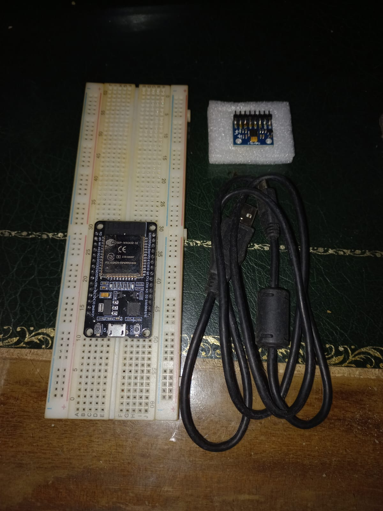

## 30-09-2026

**Actividades realizadas**

* Recepción de los materiales provistos por la cátedra para el desarrollo del proyecto:
  * Placa de desarrollo ESP32
  * Módulo sensor MPU6050
  * Protoboard
  * Cable USB
* Verificación física de los componentes recibidos.

## 01-10-2026

**Actividades realizadas**

* Montaje del circuito en protoboard conectando el ESP32 con el MPU6050 vía I2C.
* Configuración del entorno de desarrollo en PlatformIO.
* Carga del firmware en el ESP32 y verificación del entorno.
* Desarrollo y ejecución de 4 tests unitarios/funcionales:
  * **Test I2C:** Verificación de comunicación exitosa y detección de ID correspondiente a MPU6050 original (dirección `0x68`).
  * **Test de lectura cruda:** Adquisición continua a 100 Hz estables con un jitter de ±1 µs.
  * **Test de calibración:** Medición de la deriva del giróscopo, registrando 30°/min sin corregir y reduciéndose a menos de 1°/min tras aplicar compensación de bias.
  * **Test de Madgwick:** Validación del filtro con un tiempo de cómputo de 25 µs por muestra, adoptando un factor β = 0.1.

## 03-10-2026

**Actividades realizadas**

* Se realizaron pruebas del firmware en un segundo ESP32 disponible, ya que el hardware principal no estaba accesible en ese momento.
* Fue necesario ajustar los pines de comunicación I2C ya que la asignación de pines difería entre las placas.
* Se detectó que el bus I2C fallaba de forma intermitente en la protoboard a alta velocidad. Se redujo la frecuencia de comunicación y la conexión se estabilizó.
* Se verificó mediante un programa de escaneo I2C que el MPU6050 es detectado correctamente en la dirección esperada.
* Se desarrolló un script de validación de ángulos con una secuencia guiada de posiciones conocidas (0°, ±45°, ±90°) en cada eje.
* Primera validación: los ejes estaban bien asignados, pero el filtro sobreestimaba entre 3° y 6°. Se identificó como causa un offset en el acelerómetro.
* Se incorporó la corrección de offset del acelerómetro en el firmware. Segunda validación: el error bajó a menos de 2° en el rango ±90°. El pitch en ±90° presenta singularidad (gimbal lock), lo cual es inherente a la representación de Euler.

## 05-10-2026

**Actividades realizadas**

* Se detectó un problema recurrente: luego de algunos movimientos bruscos, el firmware dejaba de responder y enviaba siempre los mismos valores por serial.
* Se identificó que la librería de comunicación I2C quedaba bloqueada ante errores sin ser detectados. Se agregó verificación de errores en cada lectura y una rutina de recuperación automática que reinicia el bus tras varios fallos consecutivos.
* Se agregó una espera al inicio para asegurarse de que el MPU6050 esté listo antes de continuar con la inicialización.

## 06-10-2026

**Actividades realizadas**

* Se desarrolló un visualizador 3D en Processing 4 para validar el movimiento del lápiz en pantalla contra el movimiento físico del MPU6050.
* El visualizador recibe la orientación por puerto serie y representa el lápiz como un objeto 3D rotando en tiempo real.
* Se implementó la funcionalidad de resetear la orientación de referencia en cualquier momento, útil para compensar la posición inicial del sensor.
* Al validar el movimiento con el visualizador se observó que el lápiz rotaba solo incluso cuando el sensor estaba quieto, lo que indicó un problema en la implementación del filtro.

## 08-10-2026

**Actividades realizadas**

* En reunión con el docente se identificó el error en la implementación del filtro de Madgwick: se usaba un intervalo de tiempo variable medido en cada iteración, cuando el filtro requiere un intervalo fijo definido por la frecuencia de muestreo. Usar un intervalo variable altera la ganancia del filtro y genera deriva artificial en los ángulos.
* Se releyó el paper de Madgwick, en particular el Apéndice A dedicado a la implementación optimizada en C, y se reescribió la función del filtro siguiendo esa referencia.
* Se ajustó el valor de β al recomendado en el paper para uso sin magnetómetro.

## 09-10-2026

**Actividades realizadas**
* Se agregó calibración de bias del giróscopo al inicio: se toman varias muestras con el sensor en reposo, se promedian y se restan en cada lectura antes de alimentar el filtro. Esto reduce la deriva significativamente.
* Con estos cambios el lápiz dejó de rotar solo durante los primeros minutos de uso. La deriva en yaw persiste a largo plazo, lo cual es esperable al no contar con magnetómetro.
* Se subió al repositorio el firmware y el visualizador.

**Pendientes**

* Iniciar el desarrollo de la lógica para la estimación del desplazamiento lineal.
