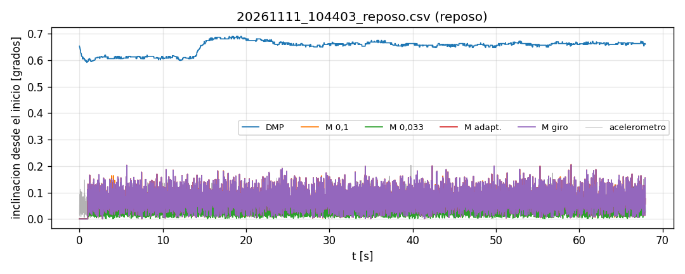
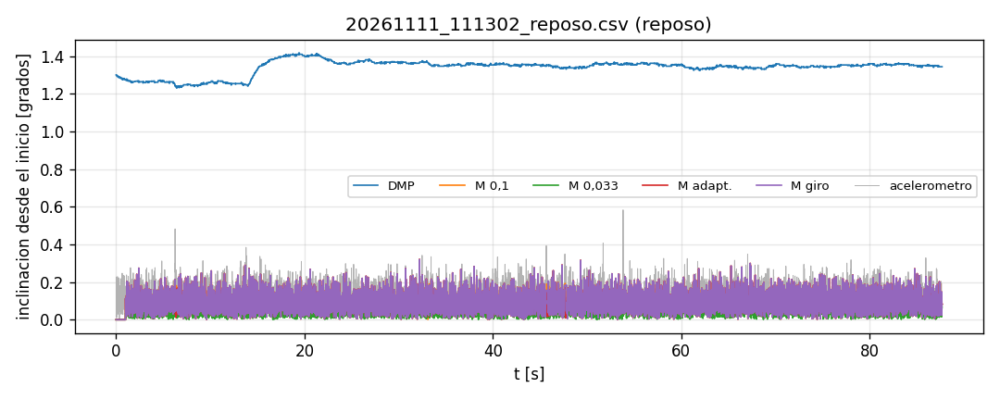
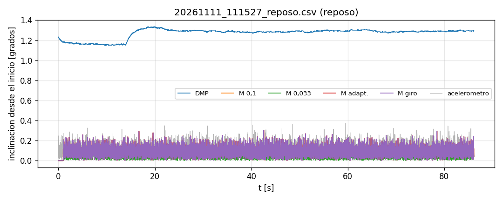
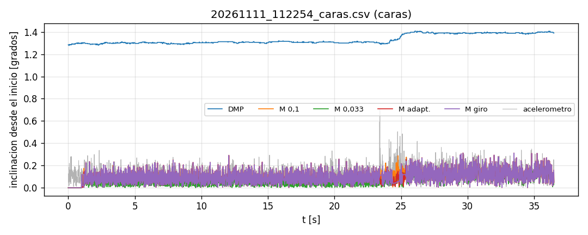
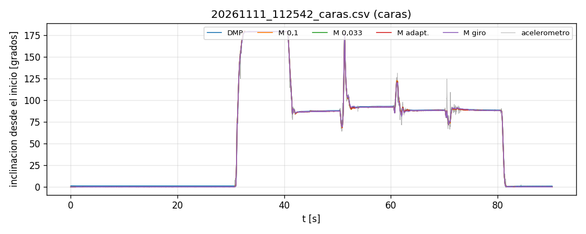
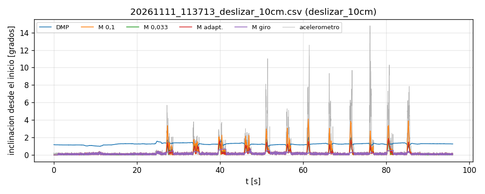
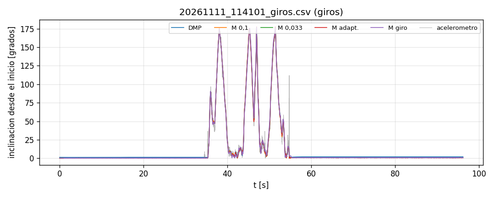

# DMP del MPU6050 contra Madgwick

Todas las variantes se calcularon sobre la misma lectura cruda de cada corrida (firmware/ensayo_dmp_vs_madgwick). Menor es mejor en todas las columnas.

Lectura del acelerometro corregida con `calibracion_acc_dmp.json` (de 20261111_112542_caras.csv); el DMP no se corrige.

## 20261111_104403_reposo.csv

Etiqueta: `reposo` · 68 s · paquetes perdidos: 0 · muestras saturadas: 6785 · **ojo: la corrida arranco antes de los 20 s del DMP**

### Reposo

| Metodo | ruido incl. [grados] | deriva incl. [grados/min] | deriva yaw [grados/min] |
|---|---|---|---|
| DMP | 0.03 | 0.03 | 0.31 |
| M 0,1 | 0.04 | 0.00 | 0.35 |
| M 0,033 | 0.02 | 0.00 | 0.35 |
| M adapt. | 0.04 | 0.00 | -0.00 |
| M giro | 0.04 | 0.00 | -0.00 |

## 20261111_111302_reposo.csv

Etiqueta: `reposo` · 88 s · paquetes perdidos: 0 · muestras saturadas: 0 · **ojo: la corrida arranco antes de los 20 s del DMP**

### Reposo

| Metodo | ruido incl. [grados] | deriva incl. [grados/min] | deriva yaw [grados/min] |
|---|---|---|---|
| DMP | 0.05 | 0.02 | 0.29 |
| M 0,1 | 0.05 | -0.00 | -0.72 |
| M 0,033 | 0.03 | -0.00 | -0.72 |
| M adapt. | 0.05 | -0.00 | -0.01 |
| M giro | 0.05 | -0.00 | -0.01 |

## 20261111_111527_reposo.csv

Etiqueta: `reposo` · 86 s · paquetes perdidos: 0 · muestras saturadas: 0 · **ojo: la corrida arranco antes de los 20 s del DMP**

### Reposo

| Metodo | ruido incl. [grados] | deriva incl. [grados/min] | deriva yaw [grados/min] |
|---|---|---|---|
| DMP | 0.05 | 0.05 | 0.22 |
| M 0,1 | 0.05 | -0.00 | 0.52 |
| M 0,033 | 0.03 | -0.00 | 0.51 |
| M adapt. | 0.05 | -0.00 | 0.00 |
| M giro | 0.05 | -0.00 | 0.00 |

## 20261111_112254_caras.csv

Etiqueta: `caras` · 36 s · paquetes perdidos: 0 · muestras saturadas: 0

### Caras: error de la inclinacion contra el acelerometro quieto

| Metodo | poses | err 0,5 s medio [grados] | err 0,5 s max [grados] | err final medio [grados] |
|---|---|---|---|---|
| DMP | 2 | 1.29 | 1.30 | 1.30 |
| M 0,1 | 2 | 0.11 | 0.15 | 0.01 |
| M 0,033 | 2 | 0.07 | 0.09 | 0.01 |
| M adapt. | 2 | 0.11 | 0.15 | 0.01 |
| M giro | 2 | 0.11 | 0.15 | 0.01 |

## 20261111_112542_caras.csv

Etiqueta: `caras` · 90 s · paquetes perdidos: 0 · muestras saturadas: 0

### Caras: error de la inclinacion contra el acelerometro quieto

| Metodo | poses | err 0,5 s medio [grados] | err 0,5 s max [grados] | err final medio [grados] |
|---|---|---|---|---|
| DMP | 8 | 1.07 | 1.33 | 1.19 |
| M 0,1 | 8 | 0.21 | 0.52 | 0.01 |
| M 0,033 | 8 | 0.19 | 0.40 | 0.01 |
| M adapt. | 8 | 0.21 | 0.53 | 0.01 |
| M giro | 8 | 0.21 | 0.53 | 0.01 |

## 20261111_113713_deslizar_10cm.csv

Etiqueta: `deslizar_10cm` · 96 s · paquetes perdidos: 1 · muestras saturadas: 0 · **ojo: la corrida arranco antes de los 20 s del DMP**

### Deslizar sin inclinar: inclinacion falsa y desplazamiento

| Metodo | trazos | incl. max media [grados] | largo medio [cm] | error medio [%] |
|---|---|---|---|---|
| DMP | 12 | 1.61 | 7.32 | 26.78 |
| M 0,1 | 12 | 3.11 | 3.25 | 67.54 |
| M 0,033 | 12 | 1.35 | 6.00 | 39.98 |
| M adapt. | 12 | 1.45 | 5.65 | 43.52 |
| M giro | 12 | 0.45 | 9.68 | 4.90 |

## 20261111_114101_giros.csv

Etiqueta: `giros` · 96 s · paquetes perdidos: 0 · muestras saturadas: 0 · **ojo: la corrida arranco antes de los 20 s del DMP**

### Giros y vuelta al mismo tope

| Metodo | no vuelve: incl. [grados] | giro neto yaw [grados] | no vuelve: yaw [grados] | duracion [s] | retardo vs M giro [ms] |
|---|---|---|---|---|---|
| DMP | 0.67 | 179.43 | 0.57 | 20.61 | 9.96 |
| M 0,1 | 0.63 | 179.91 | 0.09 | 20.61 | 0.00 |
| M 0,033 | 0.64 | 180.03 | 0.03 | 20.61 | 0.00 |
| M adapt. | 0.63 | 180.05 | 0.05 | 20.61 | 0.00 |
| M giro | 0.63 | 180.03 | 0.03 | 20.61 | 0.00 |

El acelerometro indica que la pose final difiere 0.64 grados de la inicial (cuanto no se volvio exactamente al tope).

